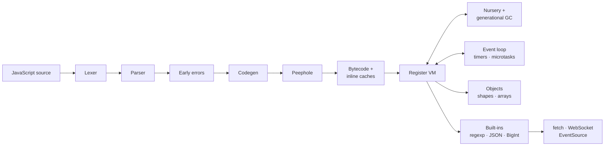

<div align="center">
  
</div>

# v16

**A fast, minimal ES2023 JavaScript engine written from scratch in Rust — hand-written lexer and parser, register-based bytecode, and a NaN-boxed virtual machine with a nursery/generational garbage collector.**

v16 is named like the engine it is: a high-displacement V16. Nothing here is borrowed from another runtime — every stage, from tokenizer to bytecode to garbage collector, lives in this repository. The result is small enough to read in an afternoon and complete enough to run real programs: async/await, generators, classes, destructuring, `fetch`, WebSockets, and a REPL.


> From source text to running bytecode in a single `cargo run`.

---

## Contents

- [Highlights](#highlights)
- [Architecture](#architecture)
- [Quick start](#quick-start)
- [Command reference](#command-reference)
- [Benchmarks](#benchmarks)
- [Test262 conformance](#test262-conformance)
- [Embedding in Rust](#embedding-in-rust)
- [Repository layout](#repository-layout)
- [Documentation](#documentation)
- [Limitations & roadmap](#limitations--roadmap)
- [Author](#author)

---

## Highlights

| Capability | What is actually implemented |
| :--- | :--- |
| **Hand-written front end** | A lexer, a recursive-descent parser, and an early-error validator covering the ES2023 grammar. No parser generator, no grammar file. |
| **Register-based bytecode** | AST → register bytecode with an inline-cache table, a peephole optimizer, and optimization levels `-O0`–`-O3`. Bytecode serializes to `.jsc` and reloads. |
| **NaN-boxed values** | Small ints, booleans, `undefined`, `null`, symbols, BigInts, interned strings, and heap pointers all fit in one 64-bit word (`src/value.rs`). |
| **Nursery + generational GC** | New objects bump-allocate in a nursery and are promoted to a tenured space. `V16_GCDUMP=…` produces activity reports. |
| **Hidden classes & inline caches** | Property access flows through `Shape`/`ShapeCache` offset transitions and polymorphic inline caches instead of name hashing. |
| **Native async** | `async`/`await`, generators, async generators, `for await…of`, and `yield*` execute without transpilation. |
| **Zero-dependency built-ins** | Regular expressions, JSON, Base64/URL codecs, BigInt, and Unicode tables are implemented in Rust inside this repo. |
| **Batteries included** | `fetch` (HTTPS via `rustls`), `WebSocket`, `EventSource`, dynamic `import()`, and `process.{exec,cwd,exit,argv,env}`. |

---

## Architecture



Three boundaries keep the engine honest:

1. **The compiler knows nothing about the heap.** Lexer, parser, early errors, codegen, and peephole produce a `Bytecode` value and nothing else.
2. **The runtime owns allocation.** `JSRuntime` owns atoms, the GC, and the module registry; `JSContext` is per-execution state. Values are only ever reached through `JSValue`.
3. **The host is optional.** `repl`, `fetch`, and `process` are feature flags; `--no-default-features` yields a bare engine with no networking and no REPL.

| Crate / module | Role | Key types |
| :--- | :--- | :--- |
| `v16-js` (this crate) | Engine, CLI, and REPL | `JSRuntime`, `JSContext`, `JSValue`, `Bytecode` |
| `src/compiler/` | Lexer, parser, early errors, codegen, peephole, opcodes | `Parser`, `CodeGenerator`, `Opcode`, `InlineCacheTable` |
| `src/runtime/` | VM, GC, event loop, modules, host extensions | `VM`, `gc_heap`, `EventLoop`, `MacroTaskExtension` |
| `src/object/` | Objects, functions, arrays, shapes, native wrappers | `JSObject`, `JSFunction`, `Shape`, `ShapeCache` |
| `src/builtins/` | Standard library and the global environment | `init_globals`, per-object `init_*` modules |
| `src/regexp/` | Self-contained regular-expression engine | `Regex`, `FastRegex`, `parser`, `compiler` |
| `src/http/` | HTTP client, TLS glue, WebSocket, SSE | `Request`, `Client`, `WebSocket` |
| `src/host/` | Embedding API types | `HostFunction`, `HostContext`, `ToJS`, `FromJS` |

---

## Quick start

### Prerequisites

| Requirement | Notes |
| :--- | :--- |
| **Rust (edition 2024)** | Built with the pinned nightly toolchain (`Cargo.toml` uses `edition = "2024"`). |
| **No C toolchain** *(default)* | The default build is pure Rust; `rustls`/`ring` is the only native dependency and only `fetch` pulls it in. |

```bash
git clone git@github.com:Kracken256/v16.git
cd v16

# 1. Build the engine (REPL + fetch + process).
cargo build --release

# 2. Run a script.
./target/release/v16 examples/process_basic.js

# 3. Or start the REPL.
./target/release/v16
```

A minimal session:

```console
$ ./target/release/v16 /tmp/demo.js
fib(20) = 6765
```

> The CLI accepts a script, a precompiled `.jsc` file, `-compile`, `-diss`, and
> `-O0`…`-O3`. Every host global — `console`, `setTimeout`, `fetch`, `WebSocket`,
> `EventSource`, `import()` — is available to scripts.

---

## Command reference

| Command | Output | Purpose |
| :--- | :--- | :--- |
| `v16 script.js` | stdout | Run a JavaScript file. |
| `v16 script.jsc` | stdout | Run precompiled bytecode. |
| `v16 -O3 script.js` | stdout | Run with an explicit optimization level (default `-O2`). |
| `v16 -compile in.js out.jsc` | `.jsc` file | Compile to serialized bytecode. |
| `v16 -diss out.jsc` | disassembly | Disassemble bytecode for debugging. |
| `v16` | REPL | Interactive shell (default `repl` feature). |
| `python3 scripts/test/test262-all.py --jobs 8` | `docs/test/` | Run Test262 and regenerate the conformance reports. |
| `./bench-v8.sh` | score table | Run the V8 benchmark suite against `qjs`, `node`, `boa`, and `v16`. |

---

## Benchmarks

`./bench-v8.sh` runs the V8 benchmark suite against every engine it finds on
`PATH` (`qjs`, `node`, `boa`) plus `v16`. Snapshot from **2026-06-15** (higher is
better):

| Benchmark         |   qjs |   node |   boa |  v16 | vs qjs |
| ----------------- | ----: | -----: | ----: | ----: | ------ |
| Richards          |   881 |  44629 |   133 |   866 |  -1.7% |
| DeltaBlue         |   875 |  88373 |   136 |   828 |  -5.4% |
| Crypto            |  1013 |  56374 |   118 |   985 |  -2.8% |
| RayTrace          |  1268 |  70299 |   276 |   589 | -53.5% |
| EarleyBoyer       |  1831 |  84585 |   341 |  1225 | -33.1% |
| RegExp            |   306 |  12316 |  58.1 |   841 | +174.8% |
| Splay             |  2206 |  44299 |   459 |  2000 |  -9.3% |
| NavierStokes      |  1759 |  54166 |   257 |  2087 | +18.6% |
| **SCORE (total)** | **1101** | **50001** | **185** | **1075** | **-2.4%** |

Ranking: **#1 node** · **#2 qjs** · **#3 v16** · **#4 boa**.

```bash
./bench-v8.sh     # downloads combined.js, builds v16, prints the score table
```

---

## Test262 conformance

v16 is continuously checked against [tc39/test262](https://github.com/tc39/test262).
The `intl402` category is included, but most of its tests are skipped because
Intl is not implemented. Per-test results are generated into
[`docs/test/`](docs/test/README.md) by the scripts in
[`scripts/test/`](scripts/test).

Snapshot from the latest run (**2026-11-24**, executed tests only; many tests are
skipped because they require unimplemented proposals or features):

| Category | Discovered | Pass | Fail | Skip | Pass rate |
| -------- | ---------: | ---: | ---: | ---: | --------: |
| `language` | 23,832 | 17,581 | 4,231 | 2,020 | 80.6% |
| `built-ins` | 23,827 | 10,240 | 7,899 | 5,688 | 56.4% |
| `harness` | 116 | 94 | 22 | 0 | 81.0% |
| `intl402` | 3,384 | 82 | 372 | 2,930 | 18.1% |
| `staging` | 1,487 | 326 | 1,015 | 22 | 22.3% |
| `annexB` | 1,085 | 567 | 515 | 3 | 52.4% |

Across the whole suite **28,890 of 53,731** discovered tests pass (67.1% of
executed tests), with about **10,700 skipped** (mostly unsupported proposals)
and ~14,000 still failing. See [`docs/test/master.md`](docs/test/master.md) for
the aggregated report and each `docs/test/<category>/master.md` for the
per-category breakdown, failure groups, and the appendix listing every
discovered test.

Regenerate the reports with:

```bash
cargo build -r --example test262_runner
python3 scripts/test/test262-all.py --jobs 8
```

---

## Embedding in Rust

```toml
[dependencies]
v16-js = "0.1.8"
```

If you don't need the REPL, `fetch`, or `process` support, opt out of the
default features to keep the dependency tree small:

```toml
[dependencies]
v16-js = { version = "0.1.8", default-features = false }
```

### Evaluate JavaScript

```rust
use v16::{JSRuntime, eval};

let mut rt = JSRuntime::new();
let mut ctx = rt.new_context();

let val = eval(&mut ctx, "1 + 2").unwrap();
assert_eq!(val.get_int(), 3);
```

### Read strings & values from JavaScript

```rust
use v16::{JSRuntime, eval};

let mut rt = JSRuntime::new();
let mut ctx = rt.new_context();

eval(&mut ctx, r#"
    function greet(name) {
        return "Hello, " + name + "!";
    }
"#).unwrap();

let val = eval(&mut ctx, r#"greet("world")"#).unwrap();
assert!(val.is_string());
let s = ctx.get_atom_str(val.get_atom());
assert_eq!(s, "Hello, world!");
```

### Call custom Rust functions from JavaScript

```rust
use v16::{JSRuntime, eval, JSValue};

fn js_print(ctx: &mut v16::JSContext, args: &[JSValue]) -> JSValue {
    for arg in args {
        if arg.is_string() {
            print!("{}", ctx.get_atom_str(arg.get_atom()));
        } else if arg.is_int() {
            print!("{}", arg.get_int());
        }
    }
    println!();
    JSValue::undefined()
}

let mut rt = JSRuntime::new();
let mut ctx = rt.new_context();

ctx.register_global_builtin("print", 1, js_print);
eval(&mut ctx, r#"print("hello from Rust!")"#).unwrap();
```

### Async/await with an event loop

```rust
use v16::{JSRuntime, eval, eval_async};

let mut rt = JSRuntime::new();
let mut ctx = rt.new_context();

eval_async(&mut ctx, r#"
    var result = null;
    (async () => {
        result = await fetch("https://httpbin.org/json");
    })();
"#).unwrap();

let val = eval(&mut ctx, "JSON.stringify(result)").unwrap();
println!("{}", ctx.get_atom_str(val.get_atom()));
```

> Requires the `fetch` feature (enabled by default). `eval_async` is `eval` +
> `run_event_loop` in one call; use `run_event_loop_with_timeout` to bound the
> loop.

### Bytecode compilation

```rust
use v16::{JSRuntime, eval, compile_to_register_bytecode};

let mut rt = JSRuntime::new();
let mut ctx = rt.new_context();

// Compile JavaScript to register-based bytecode
let (code, constants) = compile_to_register_bytecode(
    &mut ctx,
    "function fib(n) { return n < 2 ? n : fib(n-1) + fib(n-2); } fib(20)",
).unwrap();

// code: Vec<u8>, constants: Vec<JSValue>
assert!(!code.is_empty());
```

The `tests/readme_examples.rs` integration test mirrors these snippets, so keep
them in sync when you change the API.

---

## Repository layout

```text
v16/
├── Cargo.toml                  # crate, features, release profile (LTO, panic=abort)
├── bin/v16.rs                  # CLI: run / compile / disassemble / REPL
├── src/
│   ├── compiler/               # lexer, parser, early errors, codegen, peephole, opcodes
│   ├── runtime/                # JSRuntime, JSContext, VM, GC, event loop, modules
│   ├── object/                 # JSObject, JSFunction, arrays, shapes, inline caches
│   ├── builtins/               # standard library + global environment
│   ├── regexp/                 # regular-expression engine (parser, DFA, backtracking)
│   ├── http/                   # HTTP client, TLS glue, WebSocket
│   ├── host/                   # embedding API (HostFunction, ToJS, FromJS)
│   ├── util/                   # FxHash, memchr, I/O multiplexing
│   └── value.rs                # NaN-boxed JSValue
├── tests/                      # Rust integration tests (769 #[test] functions)
├── examples/                   # examples + the Test262 runner
├── scripts/test/               # Python drivers that run Test262 and write reports
├── docs/test/                  # generated conformance reports
└── test262_plan.md             # historical engineering log
```

`test262/`, `target/`, and `bench-v8/` are git-ignored (vendored suite, build
output, and benchmark checkout respectively).

---

## Documentation

| Document | What it covers |
| :--- | :--- |
| [AGENTS.md](AGENTS.md) | Architecture, conventions, and contributor rules. |
| [docs/test/README.md](docs/test/README.md) | Test262 report format and all runner flags. |
| [test262_plan.md](test262_plan.md) | Historical engineering log and working principles. |

---

## Limitations & roadmap

v16 is an engine under active development. Known limitations, stated plainly:

- **No JIT.** Code is interpreted from register bytecode; optimization happens in codegen and the peephole pass.
- **No `Intl`.** The `intl402` Test262 category is largely skipped.
- **Partial `Proxy`/`Reflect`, `WeakRef`, and `FinalizationRegistry`** support.
- **BigInt storage is `i128`**, so values beyond 2¹²⁷ are not representable.
- **`with` statements are parsed but rejected at compile time.**
- **Async `await` of a *pending* promise** does not suspend the async frame yet; settled promises are handled per spec.

Roadmap:

- Full async/await suspension on pending promises (shared coroutine machinery with generators).
- `Intl` (at least `NumberFormat`, `DateTimeFormat`, `Collator`).
- `Proxy`/`Reflect` completion and the Explicit Resource Management proposals (`using`, `await using`).
- Arbitrary-precision BigInt.
- Improving Test262 pass rates toward 100 % in `language/`.

---

## Author

**Wesley Jones** — [github.com/Kracken256](https://github.com/Kracken256)

Built with [Rust](https://www.rust-lang.org/) and, for the optional TLS path,
[rustls](https://github.com/rustls/rustls) and [ring](https://github.com/briansmith/ring).

## License

MIT
